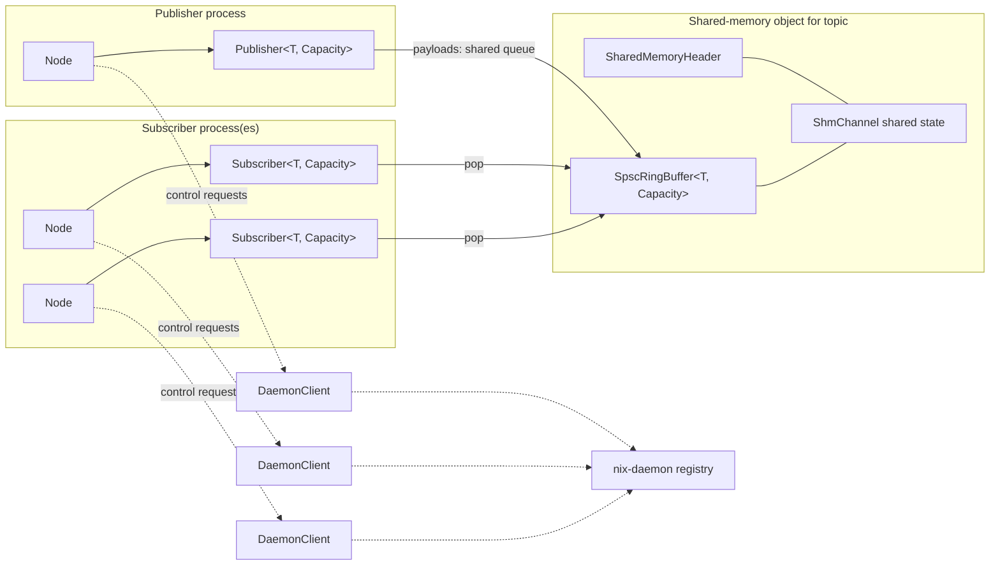

# Nix Library Architecture

This guide describes the C++ library in `nix/include/nix`, the scope of each public type, and how an application message moves through the system. The headers are the source of truth for signatures; this guide focuses on responsibilities, ownership, and behavior.

## System View

Nix has two paths with different responsibilities. The daemon is the control plane: it tracks node and endpoint registrations and answers discovery requests. Message payloads use a POSIX shared-memory channel and do not pass through the daemon.

All subscribers for one topic open the same queue. Delivery is queue-style: each message is consumed by at most one subscriber, and subscribers compete for messages. There is no current broadcast mode. A future broadcast mode would be a separate communication model and would maintain independent delivery for every subscriber.

## Message Lifecycle

1. An application constructs a `Node`, which opens a control connection through `DaemonClient`.
2. `Node::createPublisher<T, Capacity>` creates the topic's shared-memory object and registers the publisher with the daemon.
3. `Node::createSubscriber<T, Capacity>` opens the existing shared-memory object, increments its active subscriber count, and registers the endpoint.
4. `Publisher::publish` writes to the bounded shared queue. `Subscriber::receive` removes one message; `receiveBlocking` waits until one is available.
5. Endpoint destruction unregisters it. The shared-memory creator unlinks the topic name when its channel is destroyed; existing mappings remain valid until their handles close.

The publisher and subscriber must agree on the topic, message type, capacity, and type fingerprint. A subscriber rejects a shared-memory object with incompatible metadata.

## Public Types and Scope

| Type | Header | Responsibility and scope |
| --- | --- | --- |
| `Node` | `node.hxx` | Application-facing factory and discovery context. Owns the node name and a shared `DaemonClient`; endpoint objects retain that client so their registration connection can outlive the `Node` wrapper. |
| `Publisher<T, Capacity>` | `publisher.hxx` | Typed publishing endpoint for one topic. Owns a creator-mode `ShmChannel`; `publish` writes once to the topic queue. |
| `Subscriber<T, Capacity>` | `subscriber.hxx` | Typed receiving endpoint for one topic. Owns an open-mode `ShmChannel`; exposes nonblocking and blocking receive operations and shared queue status. |
| `ShmChannel<T, Capacity>` | `shm_channel.hxx` | Shared-memory transport and synchronization boundary. Maps one POSIX shared-memory object, validates its metadata, and serializes queue access using process-shared synchronization. Supports multiple publisher/subscriber handles through this synchronized channel API. |
| `SpscRingBuffer<T, Capacity>` | `spsc_ring_buffer.hxx` | Fixed-size ring storage primitive. Its own lock-free contract is single-producer/single-consumer; `ShmChannel` guards it with a process-shared mutex to provide the endpoint-level multi-producer/multi-consumer behavior. |
| `DaemonClient` | `daemon.hxx` | One node's Unix-domain-socket client for endpoint registration, unregistration, and discovery. It carries control metadata, not message payloads. |
| `EndpointInfo` | `daemon.hxx` | Value record returned by discovery: node, topic, type identifier, role, and capacity. It is a snapshot of registry data, not a live endpoint handle. |
| `EndpointRole` | `daemon.hxx` | Identifies a registered endpoint as `Publisher` or `Subscriber`. |
| `ShmMode` | `shm_channel.hxx` | Selects whether a `ShmChannel` creates and initializes a topic object or opens an existing one. |
| `SharedMemoryHeader` | `shared_memory_header.hxx` | Versioned metadata at the start of shared state. Records owner/process identity, layout and type information, and initialization status for validation and stale-object cleanup. |
| `SharedTypeFingerprint<T>` | `shared_memory_header.hxx` | Compile-time compatibility identifier for a shared-memory payload type. The default derives from compiler type signature, size, and alignment; applications can specialize it with an explicit schema version. |
| `SerializedMessage` | `serialized_message.hxx` | Fixed-size, trivially copyable envelope used by the Python binding to carry schema and encoding labels plus opaque payload bytes through the typed shared channel. |
| `SerializedMessageView` | `serialized_message.hxx` | Non-owning decoded view into a `SerializedMessage`; its string and byte views are valid only while the source message remains alive. |

### Internal `ShmChannel` Types

These are implementation details, not application-facing API:

| Type | Scope |
| --- | --- |
| `ShmChannel<T, Capacity>::SharedState` | The mapped per-topic state: header, ring buffer, active subscriber count, robust process-shared mutex, and process-shared condition variable. It is shared by all mappings of that topic. |
| `ShmChannel<T, Capacity>::MutexLock` | RAII lock wrapper. Acquires the shared mutex, handles owner-death recovery, and releases the lock on scope exit. |
| `ShmChannel<T, Capacity>::MmapDeleter` | `unique_ptr` deleter that unmaps the mapped shared-memory region when a local channel handle is destroyed. |

## Detailed Responsibilities

### `Node` and Endpoint Lifetimes

`Node` is the normal construction point for endpoints. Its factory methods construct the endpoint and register it with the daemon. A publisher or subscriber holds a `shared_ptr<DaemonClient>`, so destroying the `Node` object does not close the daemon connection while endpoints created from it remain alive. Endpoint destruction unregisters that endpoint.

The publisher's channel is the shared-memory creator and owns unlinking the POSIX name during destruction. Subscribers only unmap and close their local handles. Unlinking removes the name for future opens; it does not invalidate mappings already held by participants.

### `Publisher<T, Capacity>`

`publish(const T&)` returns `true` when the message was accepted by the channel, and `false` when the bounded queue is full. When no subscriber is active, the channel intentionally discards the message and clears stale queued content while reporting success. This is a live-stream policy, not durable storage.

The payload type must be trivially copyable for safe shared-memory storage. `Capacity` is fixed at compile time, must be a power of two, and must match across endpoints.

### `Subscriber<T, Capacity>`

`receive()` is nonblocking and returns `std::nullopt` when the shared queue is empty. `receiveBlocking()` waits for a message. `empty()` and `size()` observe the shared queue, not a private subscriber backlog. Destroying a subscriber decrements the active subscriber count; when the last subscriber is removed, pending messages are discarded.

With more than one subscriber, whichever one pops a given message consumes it. The API does not associate messages with a specific subscriber and does not replicate them.

### `ShmChannel<T, Capacity>` and `SpscRingBuffer<T, Capacity>`

`ShmChannel` owns a local mapping and file descriptor and refers to a shared `SharedState`. Its process-shared robust mutex protects all ring operations and subscriber-count updates; its condition variable supports blocking reads. The shared header is checked on open for initialization state, version, capacity, element size, and type fingerprint. An invalid or incompatible mapping is rejected.

At the public endpoint layer, `Publisher` always creates the topic object with exclusive `ShmMode::Create`, while subscribers open it. A second public publisher cannot create the same live topic object. The lower-level `ShmChannel` can open an existing object and exposes `push`, but composing extra publisher handles directly is a lower-level use of the transport API.

`SpscRingBuffer` stores the fixed-capacity slots using atomic head and tail indexes and acquire-release ordering. Used directly, it requires exactly one producer and one consumer. Within `ShmChannel`, external synchronization is what allows multiple handles to safely interact with the same ring. The ring itself does not implement broadcast or per-subscriber cursors.

### `DaemonClient`, `EndpointRole`, and `EndpointInfo`

`DaemonClient` connects to the Unix socket selected by `NIX_DAEMON_SOCKET`, or the per-user default path if the environment variable is unset. Its mutex serializes request/response exchanges over the connection. `registerEndpoint` and `unregisterEndpoint` maintain control-plane registry state; `discover` returns `EndpointInfo` records. The shared-memory transport remains usable for payloads independently of daemon discovery after endpoints are set up.

`EndpointInfo` describes registered endpoint metadata. It is useful for discovery and inspection, but it does not establish a connection to the endpoint or guarantee that it remains alive after the query.

### `SharedMemoryHeader` and `SharedTypeFingerprint<T>`

The shared-memory header allows a participant or cleanup tool to distinguish a ready Nix channel from an invalid or stale object. Its owner PID and process start time help identify stale segments without confusing a reused PID with the original owner. The initialization state prevents readers from accepting a partially initialized region.

The default type fingerprint is compiler-specific and covers the compiler's type signature plus `sizeof(T)` and `alignof(T)`. C++ cannot reliably reflect over arbitrary aggregate fields here. For long-lived or independently built producers and subscribers, specialize `SharedTypeFingerprint<T>` with an explicit schema/version value and update it when the wire layout or meaning changes.

### `SerializedMessage` and `SerializedMessageView`

These types support the Python/native boundary; they are not required for ordinary typed C++ messages. `SerializedMessage` has a fixed capacity of 64,624 bytes and is trivially copyable. The encoded frame contains:

| Field | Encoding and limit |
| --- | --- |
| Magic | Four ASCII bytes: `NIXM` |
| Version | Unsigned 16-bit big-endian; currently `1` |
| Schema length | Unsigned 16-bit big-endian; 1 to 64 printable ASCII bytes |
| Encoding length | Unsigned 16-bit big-endian; 1 to 32 printable ASCII bytes |
| Reserved | Unsigned 16-bit big-endian; must be zero |
| Payload length | Unsigned 32-bit big-endian; at most 63 KiB |
| Body | Schema, encoding, then payload, followed by zero padding |

`makeSerializedMessage` validates labels and payload bounds. `decodeSerializedMessage` validates the frame and returns a `SerializedMessageView`. The view references the input frame and should not outlive it.

## Scope Boundaries

| Concern | Owner |
| --- | --- |
| Creating endpoints and initiating discovery | `Node` |
| Typed endpoint behavior and endpoint registration lifetime | `Publisher` / `Subscriber` |
| Payload queue, shared memory mapping, synchronization, and active subscriber count | `ShmChannel` |
| Fixed-capacity slot storage | `SpscRingBuffer` |
| Node and endpoint registry metadata | `DaemonClient` and `nix-daemon` |
| Cross-language envelope framing and validation | Serialized-message helpers |

The daemon is not a broker for application messages, the queue does not provide durable delivery, and current delivery is not broadcast. Choose another transport or add a separately specified broadcast abstraction when those guarantees are required.